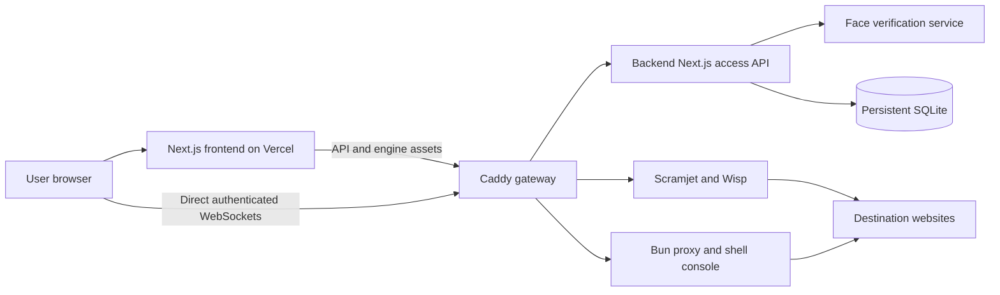

# Browser Workspace

**A self-hosted browser workspace built around Scramjet, protected by password,
face verification, passkeys, and owner-approved access.**

Browse in tabs, search the web, keep bookmarks and history, manage downloads,
run trusted page scripts, and personalize your new tab. The frontend is a
Next.js application; the actual browsing traffic travels through a separate
proxy engine and WebSocket tunnel.

**[Open the deployed workspace](https://linewizesucks.vercel.app)**
&nbsp;|&nbsp; [Full setup guide](SETUP.md)
&nbsp;|&nbsp; [Architecture and project history](worklog.md)

> This is a proxy-based browser inside a website, **not native Chrome**.
> YouTube can still require bot verification, Chrome Web Store extensions
> cannot run natively here, and the Vercel frontend needs its backend online.
> These are documented limits, not features claimed to be fixed.

## Contents

- [Quick Start](#quick-start)
- [Sign In and Approve Access](#sign-in-and-approve-access)
- [Browser Features](#browser-features)
- [Bookmarklets and Add-ons](#bookmarklets-and-add-ons)
- [How It Works](#how-it-works)
- [Deployment and Free Hosting](#deployment-and-free-hosting)
- [Configuration](#configuration)
- [Commands and Testing](#commands-and-testing)
- [Troubleshooting](#troubleshooting)
- [Security, Backups, and Recovery](#security-backups-and-recovery)
- [Project Map and Credits](#project-map-and-credits)

## Quick Start

Choose **one** way to run the stack. Start at the gateway URL, not directly
at the Next.js port: the gateway routes proxy requests and WebSockets.

### Linux / Codespaces

Install [Bun](https://bun.sh), [Node.js](https://nodejs.org) 20.9 or newer
(22 LTS recommended), and [Caddy](https://caddyserver.com/docs/install).
The lifecycle scripts also require `bash`, `curl`, and `setsid`.

From the repository root:

```bash
./start-all.sh
```

Open **http://localhost:8080**. First startup installs the locked
dependencies, creates the local environment file, generates Prisma, prepares
the SQLite schema, starts the services, and checks their health. It does not
accept destructive schema changes automatically.

```bash
./stop-all.sh
```

The stop script targets processes recorded by this checkout, not unrelated
applications that happen to use the same ports. Logs live in `.runtime/`.

For a production app instead of the development server:

```bash
./stop-all.sh
bun run build
APP_MODE=production ./start-all.sh
```

Rebuild after source changes. The development watchdog is disabled in
production so it cannot delete production build output.

### Docker Compose

With Docker and Compose installed:

```bash
docker compose up --build -d
docker compose logs -f backend
```

Open **http://localhost:8080**. Compose binds the gateway to loopback and
mounts `./db` at `/app/db`. Dependencies and runtimes are installed inside
the image; Bun and Node do not need to be installed on the host.

```bash
docker compose down
```

Do not run Compose and the native stack on the same gateway port. A fresh
empty data volume starts the setup wizard; the image does **not** contain
the original workspace's accounts or signing key.

## Sign In and Approve Access

### Existing Users

1. Open the workspace in its **own browser tab**, on the hostname where your
   passkey was enrolled.
2. Select **Member** or **Admin** and enter that role's passcode.
3. Verify the enrolled face.
4. Select **Continue with passkey** and complete the browser/OS prompt.
5. Members also need an approved account, current payment under the existing
   policy, and an owner-approved passkey before browsing opens.

An existing account without a passkey enrolls one after successful password
and face verification. Face verification alone does not issue a browsing
session. There is no silent fallback around the passkey step.

Touch ID, Windows Hello, PIN-backed passkeys, and compatible security keys
depend on your browser and authenticator. The website receives public
credential data and signatures, **not your fingerprint or private key**.
Passkeys can sync or be backed up: they are not guaranteed to belong to one
physical computer.

### Owner Approval

Sign in as **Admin**, then open **Devices**:

| Action | Effect |
| --- | --- |
| Approve passkey | Permits that member credential to complete a fresh sign-in. |
| Revoke passkey | Revokes member sessions and denies new authorized proxy requests. |
| Review observed IP/browser | Provides context for the request, not proof of device identity. |

An unapproved member sees **Owner approval required**, not the browser, and
receives no browsing session or proxy grant. After approval, sign in again.
Open Wisp and console connections are rechecked every 15 seconds; revoked
connections are closed. Authorization checks fail closed if the account
service cannot confirm access.

Owner administration remains available after full three-factor sign-in so
the owner can manage requests. Admin access opens the Admin Panel; it does
not replace the member browsing policy.

**An IP address is not a personal computer ID.** Addresses change, networks
share them, and request metadata can be spoofed. Approval is tied to a
verified passkey. The public sign-in portal remains visible while browsing
and private data require authorization.

### New Workspace / New Member

An empty database shows the first-run wizard: choose distinct member/admin
passcodes, save the one-time setup secret, and complete admin face/passkey
enrollment. Save the recovery codes offline.

New members use the enrollment flow. The owner reviews them in
**Enrollments**, confirms the existing payment policy in **Payments**, and
approves the credential in **Devices**. This repository still contains the
approval/payment policy; the separate Z.ai preview's reported payment removal
and revised registration flow were not imported.

## Browser Features

| Area | Available Features |
| --- | --- |
| Navigation | Scramjet pages, address/search suggestions, back/forward, reload, tab history, fresh routing frames per navigation. |
| Tabs | Reorder, search, duplicate, close, reopen closed tabs, and background-tab actions. |
| Search | In-app Bing results, destination-aware suggestions, retry, and reload. |
| Library | Bookmarks, history, downloads, source view, and local browsing-data controls. |
| Reading | Find in page, reader mode, printing, page zoom, and remembered per-site zoom. |
| Downloads | Download manager/shelf, cancellation, and supported pause/resume paths. |
| Customization | Summit/Ocean/Forest wallpapers, Graphite, private raster uploads, dimming, clock and shortcut toggles. |
| Scripting | Editable bookmarklets, selected-page execution, compatible add-on imports, and a Page JS console. |
| Recovery | Retry page, compatibility proxy mode, return to the full engine, and an explicit original-site link. |

The new-tab sliders icon and **Settings -> Appearance** control wallpaper
preferences. Uploaded images are resized and stored in this browser, not
uploaded to the backend. Bundled photo credits are in
[public/wallpapers/README.md](public/wallpapers/README.md).

### Internal Pages

| Address | Page |
| --- | --- |
| `about:history` | Browsing history |
| `about:bookmarks` | Bookmarks and JavaScript editor |
| `about:downloads` | Download manager |
| `about:config` | Appearance, engine diagnostics, and local data |
| `about:extensions` | Compatible extension/userscript manager |

Useful shortcuts: `Ctrl+L` for the address bar, `Ctrl+T` for a new tab,
`Ctrl+Shift+T` to reopen a closed tab, `Ctrl+F` to find, and `Ctrl+H` / `Ctrl+J`
for history/downloads. Some browser- or OS-reserved shortcuts may take priority.

### YouTube and Other Site Limits

**Full YouTube and Shorts stay on the normal Scramjet site route.** The app
does not replace them with a standalone embedded player. A direct-player
trial was removed after the user explicitly chose no embedding.

Signed-out full-site playback through the Codespace remains **unresolved**:
YouTube has returned **"Sign in to confirm that you're not a bot."** A new
VS Code extension, Neon database, or automatically created account cannot
guarantee that Google accepts this backend's network. The app does not
create shared Google accounts, import account cookies, or automate CAPTCHA
and phone verification.

Other sites can also reject proxies or datacenter traffic. DRM, restricted
media, embedded authentication, and browser-native APIs can remain
incompatible. A working webpage or thumbnail is not proof of video playback.
Use the explicit **Open original website** action when a permitted normal
browser connection is available.

## Bookmarklets and Add-ons

### Run a Bookmarklet

1. Open **Bookmarks -> New bookmark -> JavaScript**.
2. Enter a name and code, then save.
3. Load a webpage and run the saved script from the bookmarks bar, or select
   an open page under **Run on** in the bookmark manager.
4. Review the confirmation before running it.

```javascript
document.body.style.outline = "3px solid #45c6b0";
```

Raw source and encoded `javascript:` links are supported. Names and source
remain editable. Async scripts are supported, errors are reported, and a
string result does not replace the document. **Open all** opens websites
only; scripts never run automatically as bookmarks. Workspace/internal
pages and missing targets are rejected.

### Import Compatible Page Add-ons

Open the puzzle icon, **Menu -> Extensions**, or `about:extensions`. Import
a supported Manifest V3 ZIP or `.user.js`, review the matching sites, and
explicitly trust the code. Enable, disable, or remove it in the same page.
Reload matching webpages after changes.

| Supported Here | Requires Native Chrome/Chromium |
| --- | --- |
| Top-page JavaScript and CSS with explicit HTTP(S) matches | Chrome Web Store / CRX installation |
| Page context, document-end or document-idle execution | Chrome APIs and isolated extension worlds |
| Enable/disable/remove in local browser storage | Background workers, popups, native messaging, browser permissions |
| Userscripts with `@match` and `@grant none` | `GM_*` manager APIs, remote dependencies, automatic updates |

Unsupported declared capabilities are rejected, not presented as working.
Limits include a 3 MB ZIP, 750 KB of source per package, bounded archive
expansion, site-pattern validation, and local storage limits.

<details>
<summary>Minimal Manifest V3 package</summary>

Put these three files at the root of a ZIP:

**manifest.json**

```json
{
  "manifest_version": 3,
  "name": "Page Accent",
  "version": "1.0",
  "content_scripts": [{
    "matches": ["https://example.com/*"],
    "world": "MAIN",
    "run_at": "document_idle",
    "js": ["content.js"],
    "css": ["page.css"]
  }]
}
```

**content.js**

```javascript
document.body.dataset.accent = "on";
```

**page.css**

```css
body { outline: 3px solid cyan; }
```

</details>

> Run only trusted scripts. Bookmarklets and add-ons can read and modify
> matching page data; they are **not a security sandbox**. The Shell console
> is more powerful still: it executes commands on the backend host. Use this
> workspace only with people you trust with that access.

## How It Works



| Port | Service | Purpose |
| --- | --- | --- |
| `8080` | Caddy | Only public gateway; allowlisted `XTransformPort=3030/3031` routing. |
| `3000` | Next.js | App, account/session API, and administration. |
| `3030` | Bun backend | Compatibility proxy, search, and authenticated shell WebSocket. |
| `3031` | Scramjet/Wisp | Engine assets, service-worker support, and network tunnel. |
| `3032` | Face service | Server-side face enrollment and matching. |
| `3034` | Optional watchdog | Development-only monitoring; disabled in production. |

The service worker stays on the frontend origin. Vercel forwards access API
and engine-asset requests to `BACKEND_ORIGIN`; persistent WebSockets connect
directly to that backend gateway. The face service, signing key, database,
and internal ports are not public gateway targets.

## Deployment and Free Hosting

The deployed frontend is **https://linewizesucks.vercel.app**. Its current
backend is **https://ancient-wand-qvvq56g9rgv2x9xp-8080.app.github.dev**.

**Vercel alone cannot host this stack.** Login, face inference, the shell,
and browsing need the backend online. A ready frontend does not mean the
backend is awake. Codespaces can idle out, exhaust quotas, or incur usage
charges; it is not a guaranteed free always-on host.

| Component | Current Status |
| --- | --- |
| Frontend | Existing Vercel Hobby project; linked and deployed. |
| Backend compute | Running Codespace; must stay online. No new paid compute purchased. |
| Active database | SQLite on the backend's persistent data directory. |
| Neon | A Free `free_v3` resource was prepared; the project listing reports no attached resource. App data has not been migrated to Postgres. |
| Native extensions | Not supported; compatible page scripts/styles only. |

Neon hosts Postgres, **not** face inference, proxy processes, or Wisp
WebSockets. Do not point the SQLite Prisma client at a Neon URL: changing
database providers requires a tested schema/client and private data
migration that preserves accounts, encryption keys, passkeys, and counters.

For permanent hosting, use an existing machine or an eligible free VM with
sufficient resources; provider availability, quotas, terms, and overages
must be checked. The included [render.yaml](render.yaml) is a **paid example**,
not part of the free-only plan. Do not deploy it without approving its cost.

To move an existing backend: privately preserve `db/`, deploy the Docker
stack with a persistent `/app/db` mount, put HTTPS in front, set the frontend
`BACKEND_ORIGIN`, and redeploy. Keep the frontend hostname stable for enrolled
passkeys. See [SETUP.md](SETUP.md) for the full procedure.

```bash
vercel --prod
```

Publishing source, committing, pushing, and deploying are separate actions.
Never include the real database or signing key in a Git push or Vercel upload.

## Configuration

Start from [.env.example](.env.example). Keep real values in ignored local
environment files or the hosting provider's secret settings, never in chat.

| Setting | Where | Meaning |
| --- | --- | --- |
| `DATABASE_URL` | Backend / build tooling | Current SQLite default: `file:../db/custom.db`, relative to the Prisma schema. Production may use an absolute file path. |
| `BACKEND_ORIGIN` | Vercel frontend only | Exact HTTPS backend gateway origin. Build-time setting: redeploy after changing it. Never set it on the backend itself. |
| `WEBAUTHN_ORIGINS` | Backend | Comma-separated exact trusted frontend origins. No wildcards or arbitrary client hints. |
| `FORWARDED_PROTO` | Backend gateway | Use `https` behind a trusted TLS terminator. Codespaces startup sets HTTPS by default. |
| `GATEWAY_PORT` | Local lifecycle / Compose | Local gateway port; default `8080`. |
| `APP_MODE` | Local lifecycle | `production` uses the standalone build; otherwise development. |

Optional lifecycle switches: `START_APP=0`, `START_GATEWAY=0`, and
`START_WATCHDOG=0`. With a manually run Caddy, set its listener using
`CADDY_ADDRESS`; keep it consistent with the port used for health checks.

## Commands and Testing

| Command | Purpose |
| --- | --- |
| `./start-all.sh` | Prepare and start the local stack; fail if requested services are unhealthy. |
| `./stop-all.sh` | Stop the stack managed by this checkout. |
| `STOP_APP=0 ./stop-all.sh` | Stop managed services while retaining the app process. |
| `bun run build` | Generate Prisma and build the production frontend/standalone assets. |
| `bun run typecheck` | Full TypeScript check. |
| `bun run lint` | Full-project ESLint. |
| `bun run test:deployment` | Focused routing, scripting, appearance, login, and security tests. |
| `bun run db:generate` | Regenerate the current Prisma client. |
| `bun run db:push` | Apply the current schema; review changes and back up first. |
| `bun run admin:reset` | Private terminal recovery of only the admin passcode. |

### Real-browser Acceptance Tests

**Use a disposable empty backend, not your actual workspace.** The fixtures
create test passcodes, faces, approvals, and payment records. Private face
fixtures are intentionally excluded from Git and must be available locally.

```bash
bun x playwright install --with-deps chromium

E2E_FRONTEND_ORIGIN=http://localhost:9181 bun run test:webauthn

E2E_FRONTEND_ORIGIN=http://localhost:9181 \
E2E_BACKEND_ORIGIN=http://localhost:9181 \
E2E_PASSKEY_SESSION_FILE=.runtime/passkey-test-session.json \
  bun run test:browser
```

Allow the exact test origin through the test backend's `WEBAUTHN_ORIGINS`.
Use `localhost`, not an IP literal, for the local passkey RP domain. Run the
WebAuthn fixture first; it creates the authenticated fixture session used by
the browser suite. The matching Playwright container is an alternative when
host browser libraries are absent.

Coverage includes real virtual-authenticator enrollment/assertions, bad
signatures, replay, origin checks, owner approval/revocation, denied HTTP
access, valid/revoked open sockets, navigation recovery, search/reload,
bookmarklet DOM changes and errors, add-on installation, and mobile layouts.
Virtual authenticators do not prove physical Touch ID/Windows Hello hardware
behavior. A routed page or image does not prove upstream video playback.

The historical two-factor API fixture is not the current three-factor login
test. Verification records and past investigations are in [worklog.md](worklog.md).

## Troubleshooting

| Symptom | Check or Action |
| --- | --- |
| **Sign-in unavailable** | Check the backend's `/api/health`, not just the Vercel homepage. Start the stack and inspect `.runtime/app.log`. The UI retries when connectivity returns. |
| Frontend 404 / `DEPLOYMENT_NOT_FOUND` | Verify the current Vercel alias. The old `browser-workspace-eight.vercel.app` address is not the active URL. |
| Public backend 404 or GitHub login page | Check Codespaces port `8080` visibility; publish only the gateway, never internal service ports. |
| **Owner approval required** | Admin signs in, opens **Devices**, and approves the member passkey. Then the member signs in again. |
| Admin passcode rejected | Select **Admin**, not Member. Check Caps Lock and rate limits. Use private passcode recovery if forgotten. |
| Passkey rejected or prompt missing | Open a top-level HTTPS tab on the enrolled hostname. Use the enrolled authenticator or documented recovery path. |
| Camera fails | Check HTTPS, browser permission, frame restrictions, face-service health, and `.runtime/face-auth.log`. |
| Connection error 7 / internal service-worker error | Use **Retry page** or **Compatibility mode**. A blocked or offline destination may still be unreachable. |
| Compatibility page works, full engine does not | Check `/health?XTransformPort=3031`, gateway WebSocket upgrades, and `.runtime/scramjet.log`. |
| Browser works but YouTube demands sign-in | This is an observed provider restriction, not a solved playback case. No embedded-player replacement is installed. |
| Add-on refuses installation | Check the capability table. Native Chrome APIs, CRX packages, and privileged userscripts are unsupported. |
| Data vanishes after restart | Persist the backend's `/app/db` directory. Do not use an ephemeral database volume. |
| SQLite cannot open the file | Check schema-relative versus absolute `DATABASE_URL`; preserve the database and key together. |

Useful non-destructive checks:

```bash
curl --fail http://localhost:8080/api/health
curl --fail 'http://localhost:8080/health?XTransformPort=3031'
```

## Security, Backups, and Recovery

The browser UI stores bookmarks, history, appearance, downloaded-file metadata,
and installed scripts locally. Accounts, hashed passcodes, sealed face data,
passkey public credentials, approvals, and payment/audit records live on the
backend. Neither storage location should be treated as disposable by accident.

### Protect the Data Directory

Keep **both** `db/custom.db` and `db/access-engine.key` private and backed up.
Stop services before copying SQLite data, or use a consistent SQLite backup.
Restore the matching database and key together; do not generate a replacement
key when moving an existing workspace. Docker images start without these
private records and initialize only empty storage.

Never commit or publish:

- Databases, signing/encryption keys, passkey recovery material, or face fixtures.
- Real environment files, tokens, private backups, logs, or test sessions.
- The original workspace archives, which contain private account material.

Ignore and upload-exclusion files protect these paths; still inspect staged
content before publishing. A private Git repository is not a substitute for
keeping secrets out of version control.

### Recover the Admin Passcode Without Wiping Accounts

Run this **on the trusted backend host in a private interactive terminal**:

```bash
./stop-all.sh
bun run admin:reset
APP_MODE=production ./start-all.sh
```

Input is hidden; piped passcodes and command-line passcode arguments are
rejected. The command changes the admin hash and revokes admin login tokens,
while preserving members, face enrollments, payments, recovery codes,
passkeys, and the signing key. It does not bypass a lost authenticator.
Use the existing recovery-code flow for admin face/passkey recovery; see
[SETUP.md](SETUP.md). Do not delete the database to fix a forgotten passcode.

### Security Boundaries

Passcodes use scrypt, sessions/grants are signed, face templates are sealed,
and passkey verification checks exact trusted origins, challenges, signatures,
credential ownership, and supported counters. Counter checks are not a
guarantee against cloning for zero-counter or synced credentials.

Webcam matching is not hardware-backed Face ID or proven liveness detection.
Observed IPs and browser strings are not identity proof. Page scripts are not
isolated sandboxes. Authenticated shell access is host access. Dependency
advisories and deployment configuration still need review before a broad
public release; passing tests do not constitute a clean security audit.

## Project Map and Credits

| Path | What Lives Here |
| --- | --- |
| [src/app](src/app) | Next.js entry points, global styling, and access/admin/health APIs. |
| [src/components/browser](src/components/browser) | Tabs, toolbar, pages, reader, downloads, editors, and browser panels. |
| [src/components/access](src/components/access) | Sign-in, face/passkey flow, pending approval, and administration. |
| [src/lib/browser](src/lib/browser) | Engine integration, routing, page scripts, appearance, and add-on parsing. |
| [src/lib/access](src/lib/access) | Authentication, WebAuthn, encryption, billing, and session policy. |
| [mini-services](mini-services) | Proxy/search/shell, Scramjet/Wisp, face service, and development watchdog. |
| [prisma/schema.prisma](prisma/schema.prisma) | Current SQLite schema. |
| [scripts](scripts) | Build, readiness, container, production, and recovery helpers. |
| [tests](tests) | Focused and real-browser regressions. |
| [SETUP.md](SETUP.md) | Detailed architecture, deployment, migration, and recovery procedures. |
| [worklog.md](worklog.md) | Historical design decisions, debugging, experiments, and verification records. |

Lineage: adapted from **scrm-jet** (`scrm-jet.vercel.app`) by **devperson8000**,
extended into this self-hosted multi-service workspace. The separate Z.ai
preview is not a source export; its reported policy changes should not be
assumed present here without an actual import.

The browsing engine is [Scramjet by Mercury Workshop](https://github.com/MercuryWorkshop/scramjet).
WebAuthn uses [SimpleWebAuthn](https://simplewebauthn.dev/). Framework and
service dependencies are listed in [package.json](package.json). Bundled
wallpaper sources and their license are documented in
[public/wallpapers/README.md](public/wallpapers/README.md).